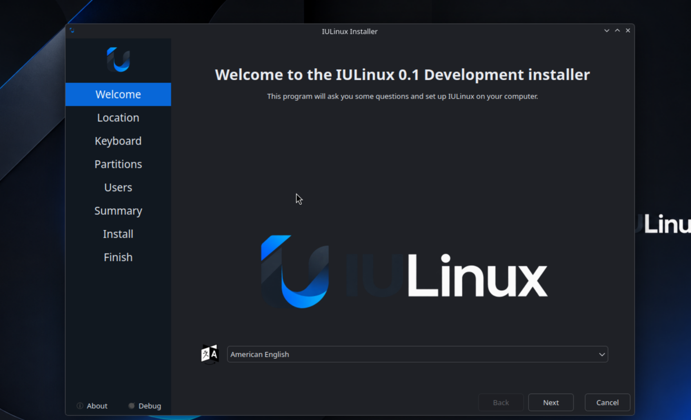
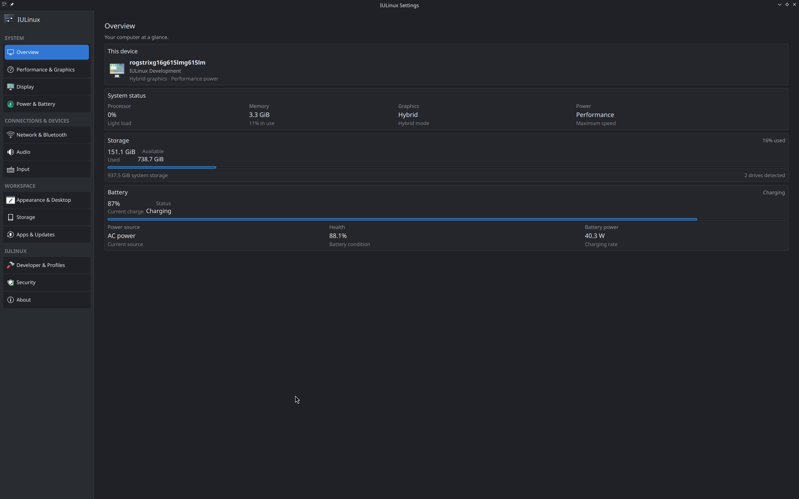
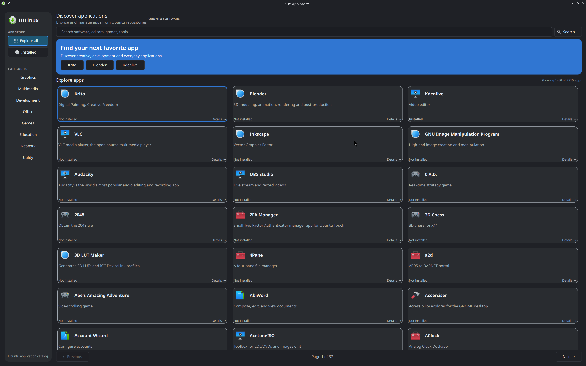
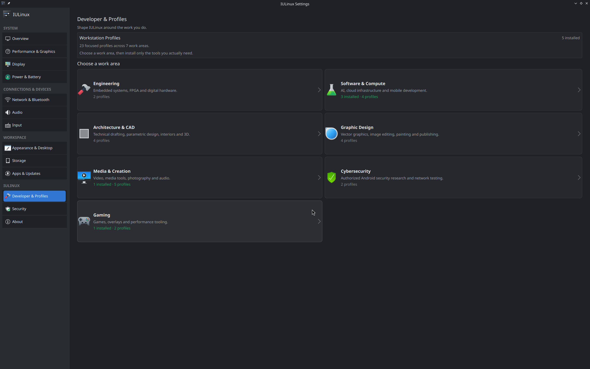

# IULinux 0.1 Alpha 1 — Technical and User Handbook

> Revision 2026-10-23 · This handbook describes the inspected Alpha implementation. It is practical documentation, not a promise of universal hardware support.



## Part I — IULinux and Alpha 1

IULinux is a KDE Plasma workstation distribution layered on Ubuntu 26.04 LTS Resolute for amd64. Ubuntu supplies the base archive, kernel, firmware packaging, initramfs, system services and much of the desktop platform. KDE supplies Plasma, the panel, launcher, Dolphin and the ordinary desktop configuration surfaces. IULinux adds the release and archive packages, desktop defaults, branded Calamares flow, IULinux Settings, the App Store integration, helper commands and optional profile manifests.

The current source calls the channel `development` and the installed release `0.1-dev`. The ISO builder uses the volume label `IULINUX_DEV`. These are real remaining development identifiers in Alpha 1 and should be included in bug reports. The public release record identifies the published packages as `iulinux-desktop 0.1~alpha1-10` and `iulinux-system 0.1~alpha1-14`.

Alpha 1 is useful for testing the integrated system, but it is not a hardware certification. Graphics, Wi-Fi, Bluetooth, suspend, Secure Boot, NVIDIA behavior and power controls depend on the computer, firmware and kernel interfaces available on that machine. Keep a backup and test on hardware where reinstalling is acceptable.

## Part II — Download, verification and installation

### Download the release

The published amd64 ISO is [IULinux-0.1-alpha1-amd64.iso](https://releases.irfanuruchi.in/IULinux-0.1-alpha1-amd64.iso). The recorded size is **2,952,669,184 bytes**. Download the matching [SHA-256 file](https://releases.irfanuruchi.in/IULinux-0.1-alpha1-amd64.iso.sha256) from the same release host. The recorded digest is `1d84879fb560819e331983a2b8cbac63051ff233a180f4e62bcf9cfe366f9604`.

### Verify on Linux

```sh
curl -LO https://releases.irfanuruchi.in/IULinux-0.1-alpha1-amd64.iso
curl -LO https://releases.irfanuruchi.in/IULinux-0.1-alpha1-amd64.iso.sha256
sha256sum --check IULinux-0.1-alpha1-amd64.iso.sha256
```

The result should report `OK`. If the checksum file uses a different filename or path, inspect it before running the check. A direct comparison is also useful:

```sh
sha256sum IULinux-0.1-alpha1-amd64.iso
```

### Verify on macOS

```sh
curl -LO https://releases.irfanuruchi.in/IULinux-0.1-alpha1-amd64.iso
curl -LO https://releases.irfanuruchi.in/IULinux-0.1-alpha1-amd64.iso.sha256
shasum -a 256 IULinux-0.1-alpha1-amd64.iso
```

Compare the printed digest exactly with the published value. macOS Disk Utility can erase a disk, but copying an ISO as a normal file is not equivalent to writing bootable media; use a trusted image-writing tool or an appropriate raw-device workflow.

### Verify on Windows

In PowerShell:

```powershell
Get-FileHash .\IULinux-0.1-alpha1-amd64.iso -Algorithm SHA256
Get-Content .\IULinux-0.1-alpha1-amd64.iso.sha256
```

Compare the two 64-character values. Do not proceed when they differ.

### Write the USB and boot the live system

Use a spare USB drive with enough capacity. The writing step destroys the selected device.

> **Destructive operation:** replace `/dev/sdX` below with the whole removable disk, not a partition. Verify the model and size twice. A wrong identifier will erase another disk.

On Linux, identify the device before unmounting it:

```sh
lsblk -o NAME,SIZE,MODEL,TRAN,MOUNTPOINTS
sudo umount /dev/sdX1
sudo dd if=IULinux-0.1-alpha1-amd64.iso of=/dev/sdX bs=4M status=progress conv=fsync
sync
```

Use a graphical imaging tool on Windows or macOS if you do not already understand raw-device selection. Boot from the USB using the firmware boot menu. Hardware-specific boot options, Secure Boot enrollment and graphics initialization are not guaranteed by the ISO alone.

### Install with Calamares

The inspected configuration shows Welcome, Locale, Keyboard, Partition, Users and Summary pages, followed by the installation sequence and a Finished page. Read the summary carefully. If you choose manual partitioning, identify the existing operating-system partitions and EFI System Partition before changing anything.

1. Start the live session and open the IULinux installer prompt or `iulinux-installer`.
2. Select language, region and keyboard layout.
3. Choose the installation disk or manual partitioning mode.
4. Review filesystem, mount-point and bootloader changes in Summary.
5. Create the user account and password.
6. Start installation and wait for the Finished page.
7. Reboot, remove the USB when firmware requests it, and sign in.
8. Open IULinux Settings, connect to the network, and apply updates after confirming repository state.

The Calamares bootloader configuration uses the EFI identifier `ubuntu` because Ubuntu signed GRUB expects the stock EFI/ubuntu location. It sets `installEFIFallback: false`. This is a project configuration detail, not a claim that Secure Boot works on all firmware.

### Identify an installed system

After first boot, collect identity without relying on a desktop label:

```sh
cat /etc/iulinux-release
cat /etc/os-release
dpkg-query -W -f='${Package} ${Version}\n' iulinux-release iulinux-system iulinux-desktop
```

The expected Alpha source identity is `IULinux 0.1-dev`, Ubuntu base `26.04 LTS (Resolute)`, development channel. The published package line is more specific: `iulinux-desktop 0.1~alpha1-10` and `iulinux-system 0.1~alpha1-14`. If these disagree, record both outputs in a bug report; do not edit release files by hand.

### Live-session hardware checks

Before installing, verify the devices that matter for your intended use:

```sh
uname -m
lsblk -o NAME,SIZE,MODEL,TRAN,MOUNTPOINTS
ip link
rfkill list
```

`x86_64` confirms the target architecture. `ip link` and `rfkill` show whether a network device is visible and blocked; they do not prove that a particular Wi-Fi network will work. Test audio playback, suspend if practical, external displays, Bluetooth pairing and the installer itself in the live session. A live-session success is useful evidence but does not prove the installed system will behave identically.

### Installation decision table

| Situation | Safer choice | Reason |
|---|---|---|
| Empty test disk | Automatic partitioning after confirming the disk | Fewer manual layout mistakes |
| Existing OS you must keep | Manual partitioning after a backup | You must preserve the existing filesystem and EFI entries |
| Unclear disk identifiers | Stop and inspect `lsblk` again | Do not guess at a destructive target |
| Legacy BIOS-only machine | Confirm firmware mode and Alpha support first | The inspected Calamares configuration is built around UEFI/GRUB behavior |
| Secure Boot required for policy reasons | Test the target firmware with the live media before installation | Signed Ubuntu components do not guarantee every firmware path |

After installation, verify the mounted root and boot mode before making changes:

```sh
test -f /etc/iulinux-release && cat /etc/iulinux-release
test -d /sys/firmware/efi && echo 'UEFI session' || echo 'non-UEFI session'
findmnt /boot /boot/efi 2>/dev/null || true
systemctl --failed
```

An empty failed-unit list is useful but not a complete health certificate. Investigate any failed unit before installing profiles or changing power settings.

## Part III — Using the KDE desktop

The desktop package depends on Plasma Desktop and Plasma Workspace and supplies IULinux theme/defaults, panel layout, wallpaper, SDDM theme, Ptyxis and Resources defaults, widgets and helper integration. Use the application launcher to search installed programs; use the panel for pinned applications, notifications, network, audio and power controls.

### Everyday tasks

- **Files:** open Dolphin from the launcher or panel. Use the location bar for paths, split views for copying between directories, and the removable-device entry before ejecting media.
- **Network:** open the panel network control to select Wi-Fi or wired connections. Bluetooth availability depends on the adapter and kernel support.
- **Displays:** use Plasma Display Configuration for ordinary monitor arrangement, resolution and scale. IULinux Settings exposes the same detected display information in its Display page.
- **Audio:** use the panel volume control for quick changes. IULinux Settings reports current output/input devices and provider state.
- **Terminal:** Ptyxis is the configured terminal. Commands in this Handbook assume a normal user shell; commands beginning with `sudo` request administrator access and should be read before execution.

### What comes from KDE and what IULinux changes

The application launcher, Plasma panel, Dolphin file manager, display configuration, ordinary network controls and desktop customization are KDE/Ubuntu facilities integrated by the IULinux desktop package. IULinux changes defaults around them: `iulinux-desktop` supplies the global theme, panel layout, wallpaper, SDDM theme, desktop defaults, widgets, Ptyxis and Resources defaults. This distinction matters when diagnosing behavior. A Plasma setting may be documented upstream, while an IULinux-specific default or helper belongs in an IULinux bug report.

For a reproducible desktop report, record the session and package state:

```sh
echo "$XDG_CURRENT_DESKTOP / $XDG_SESSION_TYPE"
plasmashell --version
dpkg-query -W -f='${Package} ${Version}\n' plasma-desktop plasma-workspace iulinux-desktop
```

Do not remove the IULinux desktop metapackage to experiment with an individual Plasma component. The package tracks the supported dependency set and may restore required defaults on later updates.

## Part IV — IULinux Settings

Launch the application with:

```sh
iulinux-settings
```

The QML navigation in `overlay/usr/lib/iulinux/settings/Main.qml` implements the following pages. Values are observations from the running system/backend; unsupported hardware is shown as unavailable rather than made up.

| Page | What it shows or controls | Persistence and caveats |
|---|---|---|
| Overview | CPU, power mode, storage summary, battery/AC state and system identity | A summary; values depend on providers |
| Appearance | Theme, font and desktop appearance state | Changes use Plasma/KDE configuration and may persist |
| Display | Connected outputs, resolution, refresh and scale | Depends on the display service and GPU; apply changes carefully |
| Audio | Default output/input, volume, mute, ports, drivers and provider | Depends on the active audio service and devices |
| Input | Keyboard layout/model and detected mouse, touchpad, touchscreen and tablet counts | Reports Linux input devices; hardware controls may remain in Plasma |
| Network & Bluetooth | Primary connection, addresses, Wi-Fi/network provider, Bluetooth controller and block state | Radio availability and permissions are hardware/kernel dependent |
| Apps & Updates | App/package status, firmware metadata, AppStream/PackageKit status and update counts | Package transactions require system authorization and network/repository health |
| Power & Battery | Battery details, power mode and processor power-limit information when exposed | Advanced limits are conditional, can increase heat/noise, and are not universal |
| Performance | Power mode, graphics/performance status and supported advanced controls | Supported hardware only; some changes may require a graphics restart |
| Profiles | Categories, installed counts and package-backed profile actions | Profiles are optional and can add substantial packages and disk use |
| Security | Ubuntu security infrastructure, kernel security and protection status | It does not replace firmware or application security review |
| Storage | Drives, volumes, mounts, filesystem and used/free summaries | Reports storage; it is not a disk partition editor |

The Power/Performance screens deliberately describe processor limits as conditional. The source warns that higher limits can increase temperature, fan noise and consumption; extreme or unsupported ranges may reduce stability. If the page says no supported processor power-limit interface was identified, leave firmware/kernel ownership unchanged. A capability can be visible for information without being a validated control.

### Page-by-page behavior

**Overview** combines backend identity, CPU description, power mode, storage totals and battery/AC information into a dashboard. It is a summary view; it does not own every underlying setting. A stale value should be compared with the provider command before reporting a Settings bug.

**Appearance** reads the current desktop appearance state and exposes the supported theme/font controls implemented by `AppearanceDesktopPage.qml`. It delegates persistence to KDE configuration rather than maintaining a second IULinux-only theme database. If the visual change disappears after logout, compare the KDE configuration and check whether the session can write the user configuration directory.

**Display** reports connected outputs, titles, resolution, refresh rate and scale. The page describes the Plasma display service as its configuration path. A monitor that is physically detected but absent from the page is a display-stack or GPU/provider issue; use `kscreen-doctor -o` where available and capture the output before changing modes.

**Audio** reports the default output and input, volume, mute state, ports, driver/state fields, provider name and device counts. It can show that no output or microphone is currently available. The page does not replace the desktop audio mixer; use `pactl` and the panel controls to distinguish a missing device from a muted device.

**Input** reports keyboard model/layout/variant/options and counts of mouse, touchpad, touchscreen, tablet and other devices. The source describes these as hardware exposed through the Linux input subsystem. It is primarily diagnostic; advanced per-device tuning remains in the desktop/input stack.

**Network & Bluetooth** reports the primary network, addresses, provider, Bluetooth controller, powered state, connected-device count and hard/soft block state. A hard block generally requires a hardware switch or firmware change; a soft block can often be changed through the normal desktop controls. The page cannot create a Bluetooth controller or network device that the kernel does not expose.

**Apps & Updates** combines application/package status, firmware metadata and IULinux update counts. Its text explicitly identifies AppStream and PackageKit when those providers are available. Package operations remain authorization-gated and should be verified with APT/dpkg after the UI reports completion.

**Power & Battery** reports battery details, mode and processor power-domain information. When a supported processor interface is detected, the page exposes sustained and short-term limits with range guidance. The source warns about heat, fan noise, throttling, reduced responsiveness and stability; values are not portable between CPUs.

**Performance** presents power mode and graphics/performance status and can surface advanced controls only when verified hardware support exists. A graphics restart prompt is a state transition; save work first and confirm the session returns normally. Do not interpret a visible slider as proof of safe overclocking.

**Profiles** loads JSON profile state and organizes available profiles by category. The page shows installed counts and confirmation flows, but package resolution is still handled by the profile/package backend. A profile card is not proof that every package is available on the current mirror.

**Security** reports the Ubuntu security infrastructure and kernel security state exposed by the backend. It is a status surface, not an antivirus replacement or a policy editor. Keep APT signatures, privilege boundaries and Ubuntu protections enabled while diagnosing other pages.

**Storage** reports physical drives, volumes, mounts, filesystem information, used/free totals and removable counts. It is not a partition editor and should not be treated as permission to format or repair a device. Use `lsblk -f`, `findmnt` and backups before any destructive storage operation.

### Settings page diagnostic reference

The following checks correspond to the data providers used by the QML pages. They are read-only unless explicitly marked otherwise.

| Page | Useful check | Interpretation |
|---|---|---|
| Overview | `uname -a`, `df -h /` | Confirms kernel and root storage context shown in the summary |
| Appearance | `kreadconfig6 --file kdeglobals --group General` | Shows KDE configuration values; do not edit while diagnosing a theme issue |
| Display | `kscreen-doctor -o` when available | Reports outputs and modes exposed to Plasma; availability varies |
| Audio | `pactl info`, `pactl list short sinks` | Shows the audio server and visible output devices |
| Input | `lsusb`, `libinput list-devices` when installed | Shows physical devices and input-stack exposure |
| Network & Bluetooth | `nmcli device`, `rfkill list`, `bluetoothctl show` | Separates NetworkManager visibility, radio blocks and Bluetooth controller state |
| Apps & Updates | `apt-cache policy`, `systemctl status packagekit` | Separates repository/package state from the Store UI |
| Power & Battery | `upower -d`, `powerprofilesctl get` | Reports provider state; it does not expose every firmware limit |
| Performance | `powerprofilesctl list`, GPU helper output | A missing provider is a capability limitation, not necessarily a failure |
| Profiles | `iulinux-profile --help`, `iulinux-profile list` | Confirms the installed command and manifest visibility |
| Security | `apt policy`, `systemctl --failed` | Confirms package trust path and failed service state |
| Storage | `lsblk -f`, `findmnt` | Distinguishes a visible disk from a mounted filesystem |

If a page reports an unavailable provider, capture the page text and the corresponding check. Do not substitute a guessed value or describe an unsupported control as persistent. Settings that delegate to Plasma or a system service generally persist through that service; this should be verified on the target machine rather than assumed from the QML page alone. Actions that request a graphics restart or administrator authorization should be treated as state-changing operations.

### Settings implementation notes and safe use



Figure — The authentic IULinux Settings overview, included to show the documented page layout and status-oriented controls.

The Settings window is assembled by `overlay/usr/lib/iulinux/settings/Main.qml`. Its page list is not a placeholder: the file creates page instances for Overview, Performance, Display, Power & Battery, Network & Bluetooth, Audio, Appearance, Input, Storage, Apps & Updates, Profiles, Security and About. Each page receives a shared backend object from `overlay/usr/lib/iulinux/settings/main.py`. The QML pages format provider JSON and expose the controls that the backend advertises.

#### Overview

Open Overview immediately after installation to establish a baseline. Record the CPU description, current power mode, storage total/free values, number of drives, battery/AC state and the identity information shown. These fields are informational summaries. They are useful for comparing a live report with commands, but the Overview page is not the authority for changing the power mode or partitioning storage.

```sh
uname -m
df -h /
upower -d | sed -n '1,100p'
```

If storage is shown as unavailable, first check whether `/` is mounted and whether the storage provider returned data. If the CPU description is generic, record the kernel and architecture; do not infer a missing CPU feature from a display label.

#### Appearance

Appearance reads the desktop appearance state and exposes the controls implemented in `pages/AppearanceDesktopPage.qml`. The page can show the active theme and font information and uses KDE configuration for the resulting desktop state. The page does not install arbitrary themes or maintain a separate theme database. A change that survives logout is a KDE configuration result; a change that reverts should be diagnosed with the user configuration and session logs.

```sh
printf 'KDE session: %s\n' "$XDG_CURRENT_DESKTOP"
test -d "$HOME/.config" && echo 'user configuration directory exists'
kreadconfig6 --file kdeglobals --group General 2>/dev/null || true
```

The command is read-only. Do not edit KDE configuration files while comparing a Settings result unless you have a backup and a specific recovery plan.

#### Display

Display uses `pages/DisplayPage.qml` and the backend display report to list connected outputs, resolution, refresh and scale. Select only modes shown by the page or Plasma display configuration. A display change can be immediately visible and may require a session or graphics restart; save work before applying it.

```sh
kscreen-doctor -o 2>&1 || true
journalctl -b --no-pager | rg -i 'drm|modeset|kwin|display' | tail -80
```

The first command is diagnostic and may not be installed in every session. If an output appears in `xrandr` or kernel logs but not in the Settings page, report the provider output and GPU/firmware details. IULinux does not guarantee a mode that the kernel or monitor rejects.

#### Audio

Audio uses the provider JSON exposed to `pages/AudioPage.qml`. It reports the default output and input, volume/mute, ports, device counts, server/provider and state/driver fields. The page can explain that no output or input is available; that is different from a muted or misrouted output.

```sh
pactl info 2>/dev/null | sed -n '1,40p'
pactl list short sinks 2>/dev/null || true
pactl list short sources 2>/dev/null || true
```

Use the panel mixer to select an output before changing application settings. If the provider is absent, preserve the `pactl` error and journal output. The Settings page does not promise that every HDMI codec, USB headset or Bluetooth profile is available.

#### Input

Input reads the keyboard and device counts exposed by the Linux input provider. It can show keyboard model/layout/variant/options and counts for mouse, touchpad, touchscreen, tablet and other devices. These are mostly informational fields; the page does not replace Plasma's keyboard or touchpad configuration.

```sh
libinput list-devices 2>/dev/null || true
lsusb
```

A device count of zero can be normal on a desktop without that class of hardware. A built-in keyboard missing from both the page and `libinput` is a kernel/firmware/input-stack problem, not a reason to invent a Settings value.

#### Network & Bluetooth

`pages/NetworkBluetoothPage.qml` separates primary network information from Bluetooth state. It can report network type, addresses, provider, controller name, powered state, connected count and hard/soft blocks. Use the panel or Plasma network controls for normal connection changes.

```sh
nmcli device status
nmcli connection show --active
rfkill list
bluetoothctl show 2>/dev/null || true
```

Authentication may be requested by NetworkManager or Polkit for a connection policy. A hard block cannot normally be cleared from the Settings page; inspect a physical switch, firmware setting or airplane-mode control. A soft block can often be cleared through the desktop radio control. Verify the active connection after any change with `nmcli`, not only the Settings label.

#### Apps & Updates

`pages/AppsUpdatesPage.qml` combines package status, firmware metadata and update counts. It distinguishes IULinux updates from broader application/package information and displays provider text such as AppStream or PackageKit when available. The page is a status and entry point; it does not bypass APT, PackageKit or authorization.

```sh
apt list --upgradable 2>/dev/null | sed -n '1,80p'
apt-cache policy iulinux-system
systemctl is-active packagekit 2>/dev/null || true
```

Treat a count of zero cautiously when metadata is unavailable. Compare the provider status and `apt update` result before concluding that the system is current.

#### Power & Battery

`pages/PowerBatteryPage.qml` is the most hardware-sensitive page. It reports battery data and power mode, then inspects processor power-limit domains when a supported interface is exposed. The source distinguishes sustained power (PL1) from short-term power (PL2), displays access labels, and provides range guidance. It can also report other power information that is for information only and not a validated control.

```sh
upower -d | sed -n '1,160p'
powerprofilesctl get 2>/dev/null || true
```

Only change a processor control when the page identifies the domain and the access state as supported. Record the original values, use conservative values, monitor temperature/fan/throttling behavior, and verify stability under the workload that matters. Higher values can increase heat, noise, consumption and throttling; lower values can cause stutter or large performance loss. A page that says no supported interface was found is an expected result on many systems.

#### Performance

`pages/PerformancePage.qml` presents the shared power mode and graphics/performance status. It can show advanced controls only when verified hardware support is present. Some graphics changes request a restart; the QML code exposes a restart-required prompt rather than silently pretending that the current session changed.

```sh
powerprofilesctl list 2>/dev/null || true
systemctl --user status plasma-kwin_x11 plasma-kwin_wayland --no-pager 2>/dev/null || true
```

Do not interpret a performance selector as an overclocking interface. The page is constrained by the kernel, firmware, graphics driver and provider permissions. Verify a change by checking the provider state and observing a stable session after any requested restart.

#### Profiles

`pages/ProfilesPage.qml` loads profile JSON, categories and installed counts and presents confirmation flows. It does not itself define the package lists. The source of truth is the manifest under `/usr/share/iulinux/profiles`, generated from the repository `profiles/` tree. If the GUI and CLI disagree, record both outputs and inspect the installed manifest before changing packages.

#### Security

`pages/SecurityPage.qml` describes Ubuntu-maintained security infrastructure and kernel security status. It is intentionally conservative: it reports protection state and does not offer a button to disable APT verification, Polkit or Secure Boot. A warning on this page should lead to evidence collection, not a security bypass.

#### Storage

`pages/StoragePage.qml` reports drive, volume, mount, filesystem, used/free and removable-device information. It can show a high-use warning and provider details, but it is not a partition editor. Use the page to identify a problem, then verify the device with `lsblk -f` and `findmnt`. Never infer that a visible drive is safe to format.

## Part V — App Store and package management

The App Store is started with:

```sh
iulinux-app-store
```

Its catalog reads local AppStream metadata through `catalog.py`; it does not fetch arbitrary remote icons. PackageKit modules resolve package identities and simulate actions before guarded transactions. PolicyKit/PackageKit authorization is used for system changes, and the transaction code fails closed when the expected action, package identity or resulting dpkg state does not match. This makes the Store a discovery and transaction UI over the package system, not a separate package universe.

APT remains the authority for package installation and updates. Ubuntu packages and IULinux packages coexist; inspect origin and candidate versions with:

```sh
apt policy iulinux-system
dpkg-query -W -f='${Package} ${Version} ${Architecture}\n' 'iulinux-*'
cat /etc/apt/sources.list.d/iulinux.sources
```

The desktop control file requires `appstream` and `gir1.2-appstream-1.0`. An earlier missing-AppStream problem is therefore a historical dependency concern, not evidence that the final Alpha package intentionally omits those dependencies. If the catalog is empty, check network reachability, AppStream metadata and the complete App Store error before changing packages.

### App Store transaction workflow

The App Store path is deliberately layered:

1. `catalog.py` loads the local AppStream pool and applies the curated metadata rules.
2. The QML interface requests package information from the PackageKit client.
3. The preview helper asks PackageKit to simulate the requested operation.
4. The transaction-eligibility module checks that the action and package identity are allowed.
5. PackageKit/Polkit performs the authorized operation.
6. The apply helper compares the resulting dpkg state with the expected result.

The preview is not a cosmetic confirmation. It is intended to catch an already-installed target, an unexpected package identity or a transaction that cannot be resolved. If a transaction fails, preserve the full error, then compare installed state before and after:

```sh
dpkg-query -W -f='${Package} ${Status} ${Version}\n' PACKAGE_NAME
apt-cache policy PACKAGE_NAME
systemctl status packagekit --no-pager
journalctl -u packagekit -b --no-pager -n 100
```

Replace `PACKAGE_NAME` with the package named by the Store. Do not run a second install repeatedly while the first PackageKit transaction is still finishing. A cancellation request is not the same as proof that a transaction stopped; verify dpkg state.

If the catalog is empty, distinguish three cases: AppStream metadata is absent or stale; the AppStream library cannot be imported; or the network/repository is unavailable for package resolution. The Store cannot manufacture metadata for a package that is not present in the local catalog.

For normal updates, keep Ubuntu and IULinux signature verification enabled:

```sh
sudo apt update
sudo apt full-upgrade
iulinux-update
```

Use the smaller `apt policy` and `dpkg-query` checks first when diagnosing an unexpected update.

### App Store workflow diagram



Figure — The authentic IULinux App Store view; package identity, metadata and transaction state remain backed by AppStream, PackageKit and dpkg.

```text
User search
    |
    v
AppStream pool -- missing/invalid metadata --> catalog error
    | component/package identity
    v
PackageKit resolver -- cannot resolve --> preview error
    | simulated action and exact package identity
    v
Eligibility check -- mismatch/unsafe --> fail closed
    | allowed install/remove request
    v
Polkit authorization -> PackageKit transaction -> dpkg state
                                                     |
                                                     v
                                       apply-stage verification
```

The arrows are boundaries, not interchangeable implementations. AppStream describes applications and metadata; PackageKit resolves and executes package transactions; Polkit authorizes privileged operations; dpkg records installed state; APT supplies the repository and dependency solver underneath the PackageKit APT backend.

### User workflow: install and remove

Open `iulinux-app-store` from the launcher or a terminal. Search for an application name and read its description, package identity and installation state. Select an uninstalled result to request a preview. The preview can reject an already-installed package, an invalid identity or a PackageKit resolution error. If the preview is valid, confirm the requested action and complete the Polkit prompt when the desktop asks for authorization.

Completion requires more than a progress bar reaching the end. Reopen the application entry, confirm its state, and compare the package record:

```sh
dpkg-query -W -f='${Package} ${Status} ${Version}\\n' PACKAGE_NAME
apt-cache policy PACKAGE_NAME
```

To remove an application, use the Store's remove action when available and read the transaction summary. Never remove a package merely because its display name resembles a base component. If the action proposes removing `iulinux-system`, `iulinux-desktop`, Plasma or the network stack, cancel and inspect package relationships with `apt-cache depends` and `apt-cache rdepends`.

### Engineering behavior and failure states

`catalog.py` creates an AppStream pool and filters the local catalog. It prefers local cached icons and records provider information. `packagekit_client.py` resolves the requested package through PackageKit and returns backend/package identity data. `packagekit_preview.py` uses PackageKit simulation and validates the returned transaction. `transaction_eligibility.py` performs fail-closed checks for interactive actions. `packagekit_apply.py` waits for completion, treats cancellation as a request rather than a forced kill, reports transaction errors, and checks that the resulting dpkg state matches the expected action.

An error can occur before authorization, during authorization, during PackageKit execution, or during post-transaction verification. Classify it before attempting recovery. The repository tests `tests/test-appstore-transaction-lifecycle.py` and `tests/test-appstore-transaction-safety.py` exercise transaction state and safety behavior without requiring a production package operation.

When a transaction is interrupted, do not launch another transaction immediately. Inspect:

```sh
dpkg --audit
ps -ef | rg 'packagekit|apt|dpkg' || true
journalctl -u packagekit -b --no-pager -n 120
```

If dpkg reports interrupted configuration, preserve the full error before considering `sudo dpkg --configure -a`. That command changes package state; it is not a harmless information query. Follow it only with a conditional `sudo apt -f install` when dependency output identifies a repair path, then verify with `dpkg --audit` and the original package query.

## Part VI — Optional workstation profiles

Profiles are read from `/usr/share/iulinux/profiles` after the overlay is applied. The source checkout contains 23 manifests; `creative` is hidden and `gaming-emulation` is a child of `gaming`. Package availability should be confirmed against the configured repositories before installation.

| Profile | Work area and packages | Maturity / cautions |
|---|---|---|
| AI | `pipx`, numerical libraries, `llama.cpp` backends | Optional local inference foundation; hardware/runtime dependent |
| Cloud / DevOps | Ansible, AWS CLI, Skopeo, Buildah, Netavark | Repository packages; container networking needs review |
| Mobile Development | ADB, Fastboot, OpenJDK 21, scrcpy | Device permissions and USB hardware apply |
| Embedded Engineering | ARM GCC, multiarch GDB, OpenOCD, DFU, AVRDUDE, serial tools | Board/debugger dependent |
| FPGA / Digital Design | Icarus, Verilator, GHDL, Yosys, GTKWave, nextpnr, openFPGALoader | Board/toolchain support varies |
| Audio Editing | Audacity | Single-package focused profile |
| Media Tools | FFmpeg and MediaInfo | Conversion/inspection tools |
| Photography | Darktable | RAW workflow; camera/codec support varies |
| Video Editing | Kdenlive and Frei0r | GPU/codec behavior varies |
| Video Transcoding | HandBrake | Encoding support depends on hardware and codecs |
| Digital Painting | Krita | Application package |
| Image Editing | GIMP | Application package |
| Vector Graphics | Inkscape | Application package |
| Publishing | Scribus | Application package |
| 2D CAD | LibreCAD | Application package |
| Parametric Design | OpenSCAD | Application package |
| 3D Design & Rendering | Blender | GPU/render backend dependent |
| Interior & Space Planning | Sweet Home 3D | Application/runtime support varies |
| Gaming | Steam Installer, GameMode, MangoHud, Gamescope, vkBasalt | Do not infer game compatibility from installability |
| Classic Emulation | ScummVM, Flatpak | No ROMs, BIOS, keys or firmware are included; optional Flathub setup is user-controlled |
| Penetration Testing | Nmap, Wireshark, tcpdump | Use only on systems and networks you are authorized to test |
| Android Security Research | ADB, Fastboot, platform-tools-common, apktool | Use only with owned/authorized devices and applications |
| Hermes Agent (Setup Tools) | Git, curl, xz-utils, ripgrep, FFmpeg | Installs prerequisites only; user installs Hermes separately |

The profile CLI is implemented in `overlay/usr/bin/iulinux-profile`. Before relying on a subcommand, use the installed command's own help output because profile behavior and options are release-dependent:

```sh
iulinux-profile --help
iulinux-profile list
iulinux-profile info PROFILE_ID
```

The manifest `packages.list` files are package inputs, not a promise that all packages are installed successfully on every mirror. Removing a profile removes packages selected by the profile workflow only when supported; review the command's plan and APT output before confirming.

### Profile verification and removal precautions

After a profile operation, verify the packages that the manifest names rather than trusting a success banner:

```sh
iulinux-profile status PROFILE_ID
dpkg-query -W -f='${Package} ${Status} ${Version}\n' PACKAGE_NAME
apt-mark showmanual | sort
```

Use the profile's exact identifier from `iulinux-profile list`. A profile may depend on Ubuntu package availability, architecture, device permissions, firmware, a compiler toolchain or a user-controlled external source. `gaming-emulation` explicitly does not include game assets or firmware. `hermes-agent` installs setup prerequisites only. `creative` is hidden, and `gaming-emulation` declares `gaming` as its parent; neither fact should be presented as a separate default desktop capability.

Before removal, read the command help and plan. Package managers track dependencies shared by multiple applications, so removing a profile can leave packages installed or propose additional removals depending on the implementation and package marks. Review the transaction summary; never confirm a removal that includes the base desktop or `iulinux-system`.

### Profile manifest structure

Each visible profile directory contains `profile.conf` and usually `packages.list`. The configuration defines `PROFILE_ID`, display name, description, default/optional tier and category. Some manifests add `PROFILE_PARENT`; `gaming-emulation` declares `gaming` as its parent. `creative` sets `PROFILE_HIDDEN=true`, so it is source evidence but not necessarily a normal GUI choice. Package lists are grouped with comments for human review, but the package names are what the installer consumes.

The repository deliberately keeps some integrations conservative. The Gaming manifest selects Ubuntu packages such as Steam Installer, GameMode, MangoHud, Gamescope and vkBasalt. The Classic Emulation manifest selects ScummVM and Flatpak and explicitly states that DOSBox Staging and PPSSPP are not supplied by the configured Ubuntu APT repositories. It includes no game files, BIOS, firmware, keys or ROMs. The Hermes manifest installs prerequisites such as Git, curl, xz-utils, ripgrep and FFmpeg; it does not install Hermes or choose a model endpoint.

Profile selection should therefore be documented as a package operation, not as a finished workstation guarantee. For example, the Embedded manifest names `gcc-arm-none-eabi`, `gdb-multiarch`, `openocd`, `dfu-util`, `avrdude`, `picocom` and `python3-serial`. That is a useful toolchain foundation, but board support, USB permissions, debugger firmware and project-specific build files remain external requirements. The FPGA manifest similarly supplies open-source HDL/synthesis/programming tools but cannot certify a particular FPGA board or vendor flow.

### Profile workflow reference



Figure — The authentic profiles screen; a profile card describes a package operation and is not proof that every package is available on the current mirror.

```text
profile.conf -> identifier/category/description
packages.list -> requested package names
        |
        v
iulinux-profile plan/status -> review package resolution
        |
        v
APT transaction -> dpkg installed state
        |
        v
status + dpkg-query + application launch -> verification
```

The installed command's usage text defines these subcommands:

```text
iulinux-profile list
iulinux-profile info <profile>
iulinux-profile plan <profile>
iulinux-profile status <profile>
sudo iulinux-profile install <profile>
sudo iulinux-profile remove <profile>
```

`list`, `info`, `plan` and `status` are read-only inspection paths. `plan` prints explicit packages, whether a dynamic resolver exists, required architectures and the profile overlay path, then states that nothing changed. `install` requires root, runs `apt-get update` when package/architecture work is needed, adds requested foreign architectures, installs packages with `--no-install-recommends`, refuses overlay collisions, records package and overlay state under `/var/lib/iulinux/profiles`, and applies optional profile policy. `remove` delegates to `/usr/lib/iulinux/profile-remove`; inspect its installed state and proposed changes before confirming. If a command offers an action, review the complete APT summary before confirmation.

## Part VII — Updates, security and troubleshooting

The independent archive is [irfanuruchi.github.io/iulinux-archive](https://irfanuruchi.github.io/iulinux-archive/). The repository package depends on `iulinux-archive-keyring`; the source template uses `Signed-By: /usr/share/keyrings/iulinux-archive-keyring.gpg`. The published fingerprint is `40618C9D664202B859FCBA2109AFED799576C2EB`. Never disable signature verification to make an update succeed.

Use this troubleshooting pattern: **symptom → likely causes → safe checks → conditional fix → verification**.

| Symptom | Safe checks | Conditional fix and verification |
|---|---|---|
| APT update fails | `sudo apt update`, `apt policy`, source file and keyring path | Correct the repository/keyring package only when output identifies it; rerun update and confirm no signature errors |
| Broken packages | `dpkg --audit`, `sudo dpkg --configure -a` only after reading the failure | `sudo apt -f install` may change dependencies; rerun `dpkg --audit` and inspect package versions |
| App Store catalog failure | Network, AppStream package, PackageKit service and full error | Repair the identified dependency/service; reopen the Store and verify catalog contents |
| Installer failure | Calamares log, storage layout, firmware mode and available disk | Correct the selected layout or firmware condition; rerun only after confirming the target disk |
| Display/graphics issue | `journalctl -b -p warning`, GPU/firmware details, whether live or installed | Use a supported Plasma/firmware path; verify a stable session before changing performance controls |
| Boot failure | Firmware boot entry, Secure Boot state, previous kernel and journal | Use recovery media and project-specific logs; do not delete EFI entries blindly |
| External disk mount unavailable | `lsblk -f`, `findmnt`, `journalctl -b` | Check cable, filesystem and mount policy; do not format a disk as a first response |

For a bug report include the release identity, ISO checksum, hardware/GPU, firmware and Secure Boot state, whether the failure is live or installed, exact command, complete error, package versions and relevant logs with secrets removed. Ubuntu security protections and APT signatures should remain enabled.

### Diagnostic procedures

#### APT signature or repository failure

**Symptom →** `apt update` reports a missing key, invalid signature, or an unexpected suite.

**Diagnosis →** inspect the configured source and keyring without deleting either:

```sh
cat /etc/apt/sources.list.d/iulinux.sources
ls -l /usr/share/keyrings/iulinux-archive-keyring.gpg
apt-cache policy iulinux-system
```

**Expected result →** the source uses the intended IULinux archive and `Signed-By` keyring, and APT can identify a candidate package. **Safe resolution →** reinstall or update the repository/keyring packages from a trusted, already configured source, or report the mismatch. **Verification →** rerun `sudo apt update` and confirm no signature warnings. Never use `--allow-unauthenticated` or remove `Signed-By` as a workaround.

#### Display or graphics initialization

**Symptom →** black screen, missing output, wrong mode or a graphics restart prompt.

**Diagnosis →** determine whether the failure is live or installed and collect:

```sh
echo "$XDG_SESSION_TYPE"
kscreen-doctor -o 2>&1 || true
journalctl -b -p warning..err --no-pager | tail -100
```

**Expected result →** the log identifies the session and any GPU/display errors. **Safe resolution →** use a known display mode and supported firmware path; do not apply unverified power or graphics limits. **Verification →** reconnect the display or start a fresh session and confirm stable output before changing another setting.

#### Audio, input, network or Bluetooth

**Symptom →** a device is absent from Settings or KDE controls.

**Diagnosis →** compare hardware discovery with the service layer:

```sh
lsusb
ip link
rfkill list
pactl list short sinks 2>/dev/null || true
bluetoothctl show 2>/dev/null || true
```

**Expected result →** the relevant device appears at the layer that owns it. **Safe resolution →** clear a user-visible radio block, reconnect hardware, or restart only the affected user/service component after recording its state. **Verification →** confirm the device reappears in both the provider command and IULinux Settings.

#### Failed boot or Secure Boot

**Symptom →** firmware cannot find the installed system or refuses the boot image.

**Diagnosis →** check firmware mode, boot entries and the previous boot log from recovery media where necessary. The inspected configuration uses `ubuntu` as the EFI identifier and disables Calamares fallback copying.

**Safe resolution →** restore the intended firmware boot entry or use the project’s documented recovery path after identifying the target ESP. Do not format the ESP or delete unrelated EFI entries as a first response. **Verification →** boot once with the same Secure Boot state and record the firmware, shim and GRUB result.

#### Storage mount failure

**Symptom →** a disk is visible but unavailable in Dolphin or Settings.

```sh
lsblk -f
findmnt
journalctl -b --no-pager | rg -i 'mount|udisks|filesystem|I/O error' | tail -80
```

Do not run filesystem repair or formatting commands until the device, filesystem and backup state are known. A missing mount can be a cable, permissions, filesystem, encryption or policy issue; the safe resolution depends on which one the logs identify.

## System architecture map

This chapter connects the user-facing applications to the files and services that implement them. It is intentionally separate from the step-by-step maintainer commands.

### Layers and data flow

```text
Ubuntu Resolute base and kernel
          |
          v
staged rootfs <- package lists + Debian packages + overlay
          |
          +-- Plasma/KDE session and IULinux desktop defaults
          +-- Settings Qt/QML pages -> Python backend -> DBus/providers
          +-- App Store QML -> AppStream / PackageKit / Polkit -> dpkg/APT
          +-- profile manifests -> iulinux-profile -> APT/dpkg
          +-- Calamares -> target filesystem + GRUB/EFI configuration
          |
          v
SquashFS + kernel/initramfs + GRUB -> ISO artifact
```

The base layer is selected by `config/build.conf`. Package lists under `packages/` select Ubuntu and IULinux components for the staged rootfs. `packaging/` contains generated Debian package inputs and control metadata. `overlay/` contains files copied into the rootfs, including QML/Python applications, helper commands, service/policy/configuration files and branding. `profiles/` is staged separately at `/usr/share/iulinux/profiles`.

### Desktop and provider boundaries

The IULinux desktop package depends on Plasma, Qt/PySide6 QML modules, AppStream, audio utilities, power-profiles-daemon and helper libraries. The Settings pages do not implement a kernel, display server, audio server, NetworkManager or PackageKit. They format data from those providers and expose only the actions represented in the backend. This is why the same page can show a useful unavailable state when a provider or hardware capability is absent.

The App Store has a similarly explicit boundary: its Python catalog reads AppStream; its PackageKit client asks the system service to resolve identities; its preview/apply helpers supervise transactions; PolicyKit authorizes privileged operations; dpkg records package state. APT remains the repository and dependency mechanism. The IULinux UI does not replace the underlying package database.

### Release and update boundaries

`iulinux-release` supplies release identity, `iulinux-repository` installs the authenticated source configuration, `iulinux-archive-keyring` supplies the public keyring, `iulinux-update` wraps the APT update/full-upgrade workflow, and `iulinux-system` tracks the supported group. The independent archive is verified using `Signed-By`; the installed system must retain that trust path.

The ISO is not the update mechanism. `scripts/build-iso.sh` packages a snapshot of the staged rootfs, kernel, initramfs and GRUB files. Installed systems receive later package changes through APT and the IULinux archive. A live ISO test therefore does not prove that an installed system has the same package candidate set after updates.

### Installer and boot boundaries

Calamares is configured by `overlay/etc/calamares/settings.conf` and module files. The visible sequence is Welcome, Locale, Keyboard, Partition, Users and Summary. The execution sequence mounts and unpacks the target, writes machine identity and filesystem configuration, applies locale and keyboard policy, creates users, configures display manager and network, copies the kernel/initramfs, and configures GRUB. `modules/bootloader.conf` selects GRUB, uses EFI identifier `ubuntu`, and disables EFI fallback copying. These are implementation facts, not a universal Secure Boot compatibility statement.

## Part VIII — Developer and maintainer reference

The source layout separates concerns:

```text
config/       build and GRUB configuration
overlay/      files copied into the staged root filesystem
packages/     package lists used by the build stages
packaging/    Debian package control files and package rootfs payloads
profiles/     optional profile manifests and package lists
scripts/      bootstrap, rootfs, overlay, package, ISO and test workflows
tests/        shell and Python release checks
build/        generated rootfs, packages and ISO outputs (not source)
```

`config/build.conf` sets the Ubuntu suite, architecture, mirrors and current development version. `scripts/bootstrap-rootfs.sh` creates the base, stage scripts install Ubuntu and IULinux components, and `scripts/apply-overlay.sh` copies `overlay/` and `profiles/` into the rootfs while preserving upstream `os-release`. `scripts/build-deb.sh` builds a package from a `packaging/<name>` tree into `build/packages`. `scripts/build-iso.sh` checks the rootfs, creates SquashFS, copies kernel/initramfs, installs GRUB files and creates the ISO with `grub-mkrescue`.

The normal published-package plan can be inspected without building:

```sh
./scripts/build-rootfs.sh --plan
```

For a local development package pipeline:

```sh
./scripts/build-rootfs.sh --plan-local
```

Actual clean builds require root privileges, a prepared host, network access, disk space and the listed tools. Review the scripts before running a clean build: `--clean` removes only the canonical `build/rootfs` path after mount-hygiene checks. Do not run it against a production root filesystem.

The release checks run from `build-iso.sh` include rootfs identity, package consistency, desktop, profile framework, live system, branding, installer and Calamares configuration tests. The repository also includes focused tests for display, audio, input, storage, power policy, App Store transaction safety, GPU policy, profiles and network behavior.

Release verification has two layers: the ISO SHA-256 published beside the artifact, and the GPG-signed APT archive verified by the installed keyring and `Signed-By` source configuration. A checksum verifies the downloaded bytes; it does not prove the ISO is free of bugs or suitable for every machine.

Contributors should make changes in the source area that owns the behavior, run the relevant focused test, run the release checks when changing packaging or ISO behavior, and report exact evidence. Keep overlay sources, staged rootfs contents, generated Debian packages and ISO contents distinct when debugging.

### Build stages in detail

The published-package rootfs plan printed by `./scripts/build-rootfs.sh --plan` is ordered, not decorative. It starts with `bootstrap-rootfs.sh`, installs the Ubuntu base, installs IULinux core from the published signed archive, adds the desktop and optional base tooling, installs the live system and Calamares, then applies the overlay. The local-development plan replaces the published core stage with `sync-local-packages.sh`. Use the plan mode first when explaining a build failure; it does not require root and does not change `build/rootfs`.

`apply-overlay.sh` has several important boundaries. It requires an existing `build/rootfs`, preserves the upstream `os-release` copy at `/usr/lib/iulinux/upstream-os-release`, rsyncs `overlay/` into the rootfs, stages `profiles/` at `/usr/share/iulinux/profiles`, tightens Netplan file permissions, and re-establishes `/etc/os-release` as a symlink. A change visible in the source checkout is not present in a staged rootfs until this step has run.

`build-deb.sh` reads `packaging/<package>/DEBIAN/control` and `packaging/<package>/rootfs`, builds a temporary package tree and emits `build/packages/<name>_<version>_<arch>.deb`. This is different from the overlay: package payloads are generated Debian artifacts, while overlay files are copied into the rootfs during the image build. Inspect both when a file appears in one build but not another.

### ISO construction and verification boundaries

`build-iso.sh` expects a completed rootfs and host tools `mksquashfs`, `grub-mkrescue` and `xorriso`. Before generating output it runs the release checks, validates kernel and initramfs paths, generates the package manifest and filesystem size, excludes caches/logs/temporary paths from SquashFS, copies GRUB branding, creates `md5sum.txt` for ISO contents, and writes the ISO SHA-256 file. The output filename is derived from `IULINUX_VERSION` and `TARGET_ARCH`; the volume ID is separately hard-coded as `IULINUX_DEV` in the current script.

The build scripts use `sudo` for rootfs and ISO operations and the clean modes remove the canonical `build/rootfs` only after checking that pseudo-filesystems are not mounted. A build is not reproducible merely because the script sequence is stable: archive state, package versions, host tools, compression versions, firmware assets and timestamps can change the result. Record the source revision, configuration, package versions, host distribution and checksum with every release candidate.

### Tests and failure triage

The ISO script invokes tests for rootfs identity, package consistency, base system, desktop, developer tools, containers, GPU base, hardware checks, workstation controls, profiles, live system, network policy, runtime policy, branding, SDDM, GRUB and installer configuration. Focused tests cover App Store transaction lifecycle and safety, processor power ranges and policy, display/audio/input/storage status, profile granularity, NVIDIA/CUDA policy and package consistency.

Run a focused test directly when the changed area is known:

```sh
tests/test-profile-framework.sh
tests/test-installer-config.sh
tests/test-package-consistency.sh
python3 tests/test-appstore-transaction-safety.py
```

These tests are source-level checks in the reference checkout. They do not replace an installed-system test on physical hardware. If a test needs a rootfs, package, GPU or service that is absent, report the prerequisite failure rather than marking the feature as broken or silently skipping it.

### Release checklist

Before publishing a new Alpha artifact, a maintainer should verify:

1. `config/build.conf` and `overlay/etc/iulinux-release` agree on the intended channel and version.
2. Package control files have matching dependencies and expected versions.
3. The rootfs plan uses the intended published or local package source.
4. All focused tests for changed areas pass.
5. The ISO is built from a mount-clean rootfs and the output size is recorded.
6. The ISO checksum is generated from the final bytes and published beside the ISO.
7. The archive repository is signed with the expected key and the keyring fingerprint is recorded.
8. The live and installed identities are checked, including the known `IULINUX_DEV` and `0.1-dev` development identifiers when they remain.
9. Installation, first boot, update, App Store and profile smoke tests are recorded with hardware and firmware details.
10. Release notes distinguish direct source evidence, historical tests and unverified hardware assumptions.

The website should link only to artifacts that have passed this checklist. A public URL alone does not establish that a release is correct.

### Maintainer field guide: tracing a change

When a user-visible behavior changes, trace it through the artifact layers rather than editing the first matching file:

1. Locate the runtime entry point in `overlay/usr/bin`, `overlay/usr/lib/iulinux`, a QML page, a service, or a package payload.
2. Identify the package or overlay stage that installs it.
3. Check the dependency declaration in `packaging/*/DEBIAN/control` and the package lists that bring it into the rootfs.
4. Update or add the focused test that describes the safety boundary.
5. Build the affected Debian package or rootfs stage in an isolated development environment.
6. Inspect the staged file under `build/rootfs` before generating an ISO.
7. Run the release checks and record the resulting package versions and checksum.

For example, changing an App Store transaction rule is not complete when `transaction_eligibility.py` is edited. The PackageKit client, preview/apply helpers, QML error path, desktop dependency set and transaction safety tests all describe the contract. Changing a Settings label may be a QML-only change; changing the value behind that label requires tracing the Python backend and its provider.

### Service and configuration debugging

Separate a missing file from a failed provider. First inspect the installed path and owning package:

```sh
dpkg -S /usr/bin/iulinux-settings
dpkg -L iulinux-desktop | rg 'iulinux/(settings|appstore)|calamares|xdg'
systemctl --failed
```

Then inspect the relevant user or system journal without copying secrets into a bug report:

```sh
journalctl --user -b --no-pager | tail -100
journalctl -b -p warning..err --no-pager | tail -100
```

The absence of a systemd unit does not prove a feature is missing: Settings and App Store components are launched applications, while PackageKit, NetworkManager, audio services and Polkit are external providers. Conversely, a visible QML page does not prove its backend has a usable provider on the current machine.

### Package dependency review

When changing a Debian control file, review the full dependency chain. `iulinux-system` is a metapackage that tracks `iulinux-release`, `iulinux-update`, `iulinux-repository`, `iulinux-archive-keyring` and the matching `iulinux-desktop` version. The desktop package carries the Qt/QML, Plasma, AppStream, audio, policy and helper dependencies needed by the installed integration. A package can build successfully while a clean rootfs fails later if its control file omits a runtime dependency.

Useful static checks include:

```sh
for package in iulinux-desktop iulinux-system iulinux-release iulinux-update iulinux-repository iulinux-archive-keyring; do
  sed -n '1,80p' "packaging/$package/DEBIAN/control"
done
tests/test-package-consistency.sh
```

Treat package version equality and dependency constraints as part of the supported installation contract. Do not solve a dependency error by installing random binaries into the rootfs or by weakening APT trust.

### Manual release smoke test

The repository tests are complemented by a repeatable manual smoke test on a disposable installed system:

| Order | Action | Record |
|---|---|---|
| 1 | Confirm `/etc/iulinux-release`, package versions and ISO checksum | Identity and artifact |
| 2 | Open Settings and visit all 12 pages | Provider availability and errors |
| 3 | Open App Store, search, preview and perform one safe package action | Catalog, auth and resulting dpkg state |
| 4 | Run `iulinux-profile list` and inspect one manifest-backed plan | Profile visibility and package plan |
| 5 | Run `sudo apt update` and inspect `apt policy iulinux-system` | Archive signature and candidate origin |
| 6 | Reboot with the tested firmware/Secure Boot state | Boot result and journal |
| 7 | Exercise network, audio, display, input, storage and suspend as available | Hardware-specific evidence |

Record failures as failures of the tested machine and release combination. A successful run on one computer is historical testing evidence, not a universal compatibility claim.

## Release record

- ISO: `IULinux-0.1-alpha1-amd64.iso`
- Size: `2,952,669,184` bytes
- SHA-256: `1d84879fb560819e331983a2b8cbac63051ff233a180f4e62bcf9cfe366f9604`
- Base: Ubuntu 26.04 LTS Resolute, amd64, KDE Plasma
- Published packages: `iulinux-desktop 0.1~alpha1-10`; `iulinux-system 0.1~alpha1-14`
- Remaining identifiers: `IULINUX_DEV` ISO label and installed `0.1-dev` identity
